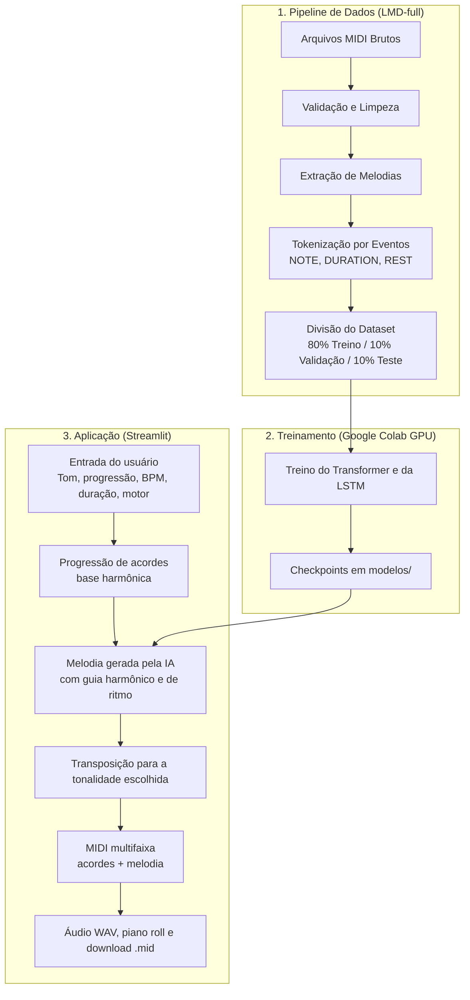

# SI-PI6-2026-G06 — Gerador de Melodias e Progressões Harmônicas com IA

Repositório oficial do **Projeto Integrador VI (PI VI)** do curso de **Sistemas de Informação (2026)**.

---

## 🎵 Visão Geral do Projeto

O projeto é uma aplicação web (Streamlit) que compõe **músicas autorais em formato MIDI (.mid)** a partir de parâmetros escolhidos pelo usuário:
- **Tonalidade / escala** (ex.: Dó Maior, Lá Menor, Sol Maior)
- **Progressão de acordes** (ex.: Pop / Hits I - V - vi - IV)
- **Andamento (BPM)**: 60 a 180
- **Duração** da peça, em segundos
- **Motor de IA** da melodia: Transformer, LSTM ou Cadeia de Markov
- **Criatividade** (temperatura de amostragem) e **instrumentos** de melodia e acordes

O resultado é uma melodia alinhada a uma faixa de acordes, com player de áudio, piano roll com os acordes e botão para baixar o MIDI.

O projeto começou como uma Prova de Conceito com Cadeia de Markov de 2ª ordem e evoluiu para modelos de Deep Learning (Transformer e LSTM, em PyTorch) treinados no dataset **LMD-full (Lakh MIDI Dataset)** com GPU no **Google Colab**.

---

## 🏗️ Arquitetura do Sistema



---

## 🎼 Harmonia + Melodia

A geração acontece em dois níveis:

1. **Base harmônica:** [`src/teoria_musical.py`](src/teoria_musical.py) monta a progressão de acordes no tom escolhido, um acorde por compasso (4/4).

2. **Melodia pela IA, guiada pela harmonia:** os modelos não recebem os acordes como entrada. Eles geram a sequência de tokens e, a cada passo, [`src/harmonia_guia.py`](src/harmonia_guia.py) ajusta as probabilidades (sem retreinar o modelo):
   - proíbe notas fora da escala e fora da tessitura da melodia;
   - favorece as notas do acorde do compasso, mais forte nos tempos fortes;
   - guia de ritmo: favorece durações que terminam no beat, para a melodia não sair do tempo da base (peso 3,0 no Transformer e 1,0 na LSTM).

   O guia pode ser desligado na barra lateral ("Guiar melodia pela harmonia").

3. **Geração em Dó Maior e transposição:** os modelos foram treinados sem transposição e rendem melhor na região de Dó Maior / Lá Menor. Por isso a melodia é gerada ali e depois transposta para a tonalidade escolhida.

4. **MIDI multifaixa:** [`src/midi_builder.py`](src/midi_builder.py) escreve uma faixa de acordes e uma de melodia, no mesmo BPM.

5. **Áudio:** [`src/audio_renderer.py`](src/audio_renderer.py) usa o FluidSynth, se ele e um soundfont estiverem instalados. Caso contrário, usa um sintetizador próprio (somas de harmônicos com envelope ADSR), então o app funciona sem instalação extra.

---

## 🤖 Modelos de IA

| Motor | Arquivo | Observações |
| :--- | :--- | :--- |
| **Transformer** | [`src/modelos/transformer_model.py`](src/modelos/transformer_model.py) | Autoregressivo (PyTorch). Atenção global captura motivos e estrutura de longo alcance. |
| **LSTM** | [`src/modelos/lstm_model.py`](src/modelos/lstm_model.py) | Stacked LSTM (4 camadas, 512 unidades ocultas). Na geração usa penalidade de repetição e viés de duração para evitar notas repetidas e ritmo uniforme. |
| **Cadeia de Markov** | [`src/modelos/markov.py`](src/modelos/markov.py) | 2ª ordem, probabilística. Serve de linha de base e de fallback quando um modelo neural não está disponível. |

Métricas no conjunto de teste (de [`relatorios/tabela_comparativa.csv`](relatorios/tabela_comparativa.csv)), medidas sobre o modelo treinado, sem o guia de geração:

| Modelo | Perplexidade | Acurácia | Top-5 | F1 macro |
| :--- | :---: | :---: | :---: | :---: |
| Transformer | 3,22 | 64,4% | 91,8% | 0,417 |
| LSTM | 3,24 | 62,7% | 91,8% | 0,398 |

Os pesos ficam em `modelos/` (`modelo_transformer.pt`, `modelo_lstm.pt`, `markov_modelo.pkl` e `vocabulario.json`) e estão versionados, então o app roda logo após o clone.

---

## 🚀 Status do Projeto

| Etapa | Descrição | Status |
| :--- | :--- | :---: |
| **Pipeline de dados** | Extração, validação, tokenização e divisão do LMD-full | ✅ Concluído |
| **POC (Markov)** | Prova de conceito com Streamlit, teoria musical e exportador MIDI | ✅ Concluído |
| **Treinamento neural** | Transformer e LSTM treinados no Google Colab | ✅ Concluído |
| **Harmonia e multifaixa** | Progressão de acordes, guia harmônico e MIDI multifaixa | ✅ Concluído |
| **Interface e áudio** | Player, piano roll com acordes e download do MIDI | ✅ Concluído |
| **Avaliação** | Métricas objetivas em `scripts/` e `relatorios/` | 🔄 Parcial: avaliação de escuta manual ainda pendente |

---

## 💻 Estrutura do Repositório

```
SI-PI6-2026-G06/
├── app.py                    # Interface Streamlit
├── src/
│   ├── gerador.py            # Orquestra a composição (acordes + melodia + MIDI + áudio)
│   ├── teoria_musical.py     # Escalas, progressões, transposição
│   ├── harmonia_guia.py      # Guia harmônico/rítmico e métricas da melodia
│   ├── midi_builder.py       # Tokens -> arquivo MIDI multifaixa
│   ├── audio_renderer.py     # MIDI -> WAV (FluidSynth ou sintetizador próprio)
│   ├── piano_roll.py         # Visualização da melodia e dos acordes
│   └── modelos/              # Markov, LSTM e Transformer
├── modelos/                  # Pesos treinados (.pt, .pkl) e vocabulário
├── scripts/                  # Pipeline de dados (00 a 05), treino e avaliação
├── notebooks/                # Notebook de treino no Google Colab
├── configuracao/
│   └── pipeline.yaml         # Parâmetros do pipeline e filtros
├── arquivos_brutos/          # Dataset original LMD-full (não versionado)
├── dados_processados/        # MIDIs válidos, sequências e splits (não versionado)
├── relatorios/               # Métricas, históricos de treino e relatórios do dataset
├── testes/escuta_manual/     # MIDIs de referência para escuta
├── documentacao/             # Documentos acadêmicos do projeto
├── assets/, .streamlit/      # Estilo e configuração da interface
├── requirements.txt          # Dependências
└── README.md                 # Esta documentação
```

---

## 🛠️ Como Executar o App Localmente

1. **Criar e ativar o ambiente virtual Python:**
   ```bash
   python -m venv .venv
   # No Windows:
   .venv\Scripts\activate
   # No Linux/Mac:
   source .venv/bin/activate
   ```

2. **Instalar as dependências:**
   ```bash
   pip install -r requirements.txt
   ```

3. **Iniciar a aplicação:**
   ```bash
   streamlit run app.py
   ```
   Acesse `http://localhost:8501` no navegador.

   Os modelos já estão em `modelos/`. Sem o PyTorch, ou sem algum dos arquivos `.pt`, o app usa a Cadeia de Markov no lugar.

**Opcional:** instale o [FluidSynth](https://www.fluidsynth.org) e um soundfont (`.sf2`) para um áudio com timbres de instrumentos reais.

---

## 🔁 Reproduzindo o Pipeline e o Treino

Só é necessário se quiser refazer os dados ou treinar novamente. Exige o dataset LMD-full em `arquivos_brutos/`.

```bash
python scripts/00_verificar_dataset.py
python scripts/01_inventariar_dataset.py
python scripts/02_validar_midis.py
python scripts/03_extrair_melodias.py
python scripts/04_tokenizar.py
python scripts/05_dividir_dataset.py

python scripts/treinar_markov.py
python scripts/treinar_neural.py --modelo transformer --epochs 15 --batch_size 32
python scripts/treinar_neural.py --modelo lstm --epochs 20 --batch_size 32
```

**Treino no Google Colab:** use [`notebooks/treinamento_google_colab.ipynb`](notebooks/treinamento_google_colab.ipynb) com GPU (**Ambiente de execução > Alterar tipo > T4 GPU**). Ao final, extraia o `.zip` baixado na raiz do projeto (cria `modelos/` e `relatorios/`) e reinicie o `streamlit run`. Em treinos longos, `scripts/manter_acordado.bat` evita a suspensão do computador.

**Avaliação da geração:**
```bash
python scripts/avaliar_geracao.py --modelo lstm --n 20     # aderência da melodia aos acordes
python scripts/medir_tempo.py --modelo lstm --n 20         # alinhamento rítmico com a grade dos acordes
```

---

## 👥 Integrantes do Grupo B6

- **Eduardo de Almeida Freitas** — RA: 24008082
- **Guilherme Henrique Alves Santos** — RA: 24015942
- **Hector Lopes** — RA: 25013988
- **Mariana Assis Ferreira** — RA: 21943527
- **Octávio Augusto dos Santos Nascimento** — RA: 24015129

**Orientador:** Prof. Dimas Augusto  
**Instituição:** Pontifícia Universidade Católica de Campinas — PUC-Campinas  
**Ano:** 2026
